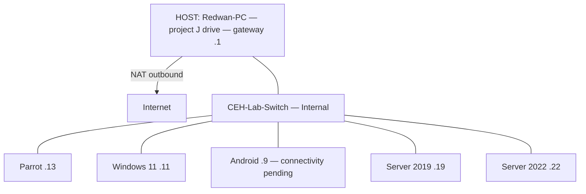

# Start here: CEH lab for beginners

Use this guide to start the existing local lab, prepare a new Windows target,
or rebuild the lab. Practice only on machines you own or are authorized to test.
The supplied Gemini guide is preserved in [reference](reference/README.md);
some of its assumptions differ from the machines reviewed on 2026-11-06.

## 1. Know where you are typing

- **Host** means the physical Windows PC running Hyper-V.
- **Guest / VM** means a computer inside Hyper-V.
- **Administrator PowerShell** means right-click **Windows PowerShell**, choose
  **Run as administrator** and accept UAC. Being signed into an administrator
  account alone is not enough for host Hyper-V commands.
- **Parrot terminal** means the Linux terminal inside Parrot, or an SSH session
  connected to Parrot.

Run `hostname` and `whoami` if unsure. After `ssh`, commands run on the remote
computer. Type `exit` to return to the previous terminal.

The repository path `J:\MyProjects\ceh-lab-setup` exists on the physical host,
**Redwan-PC**. A terminal application opened on that PC can still contain an
SSH session inside a VM. If `J:` is missing or the prompt says
`C:\Users\Administrator`, check `hostname` first. To run host commands, open a
fresh PowerShell from the physical host's Start menu, choose **Run as
administrator**, and confirm `hostname` reports `Redwan-PC`.

## 2. Understand this lab's addresses

The expected design uses `CEH-Lab-Switch`, an **Internal** Hyper-V switch; each
guest should attach to it. The host gateway and NAT are present, but current VM
switch membership and power states still need an elevated host inventory.
In this design, guests connect to each other and the host
without being attached directly to the physical LAN. NAT is not a complete
security boundary: the host and outgoing destinations remain reachable. See
[Microsoft's NAT guide](https://learn.microsoft.com/en-us/windows-server/virtualization/hyper-v/setup-nat-network).

| Machine | Address | Purpose / current limitation |
|---|---|---|
| Physical Windows host | `10.10.10.1` | Lab gateway; not a guest |
| Android-8.1-Target | `10.10.10.9` | Intended ADB target; verify port 5555 before use |
| Win11-Client | `10.10.10.11` | Windows workstation target |
| Parrot Security | `10.10.10.13` | Linux practice workstation |
| WinServer-2019 | `10.10.10.19` | Standalone WORKGROUP server; AD/DNS are not installed |
| WinServer-2022 | `10.10.10.22` | Standalone WORKGROUP server; IIS/FTP are not installed |

Guest subnet mask is `255.255.255.0` (`/24`), with gateway `10.10.10.1`.

Expected layout (the `J:` project folder belongs to the physical host):



For a new standalone guest, use DNS `8.8.8.8` and `1.1.1.1` where permitted.
Do not select `.19` as DNS until a working DNS service exists there. Do not copy
a host's loopback DNS such as `127.0.0.2` into a guest: it refers to the guest
itself. AD, DNS, web, FTP and SQL exercises need separate provisioning;
creating VMs or installing SSH does not create those services.

The review confirmed SSH TCP/22 and SMB TCP/445 on all three Windows guests,
with SMB2 enabled and SMB1 disabled. RDP TCP/3389 was not listening. Neither
server has SQL/MSSQL services installed. All four SSH-accessible guests
(Windows 11, both servers and Parrot) passed fresh ShellGPT text, shell-command
and tool-round-trip API tests. Windows 11 also passed 11 offline guard checks
after its guarded installer update; its API key was preserved. Server 2022's
key was saved to protected configuration with the user's authorization.

Windows 11 and Server 2022 had an invalid backup DNS entry pointing at `.19`.
The review corrected them to `8.8.8.8`, `1.1.1.1`; Server 2019 already used
that pair. The local [DNS helper](Set-StandaloneLabDns.ps1) is restricted to
known standalone lab guests and refuses domain controllers/domain members.

## 3. Daily use: start the existing lab

Skip installation and network setup when the VMs already exist.

1. Plug in the host and keep it awake throughout the session. A guest cannot
   keep running normally while the physical host sleeps or hibernates.
   The last observed host AC sleep timeout was **5 hours**; AC hibernation was
   disabled. A UAC elevation attempt was canceled, so the review did not change
   host power settings or complete the administrator Hyper-V inventory.
2. Open **Hyper-V Manager** on the host. Start Parrot and only the targets you
   need. Choose **Connect** if you need a VM's local screen.
3. In **Settings → Network Adapter**, confirm each VM uses `CEH-Lab-Switch`.
   Do not replace working adapters or create another NAT network as a first fix.
4. On the host, use ordinary PowerShell to check the required SSH ports:

   ```powershell
   Test-NetConnection 10.10.10.13 -Port 22
   Test-NetConnection 10.10.10.11 -Port 22
   Test-NetConnection 10.10.10.19 -Port 22
   Test-NetConnection 10.10.10.22 -Port 22
   ```

   `TcpTestSucceeded : True` means a TCP connection succeeded. It does not
   verify a password or other services. A failed ping alone does not prove
   the VM is offline.
5. Connect to the VM you need, using its own account password when prompted:

   ```powershell
   ssh redwan@10.10.10.13
   ssh Win11-Client@10.10.10.11
   ssh Administrator@10.10.10.19
   ssh Administrator@10.10.10.22
   ```

   At first connection, compare the SSH host fingerprint with the intended
   guest before accepting it. Password typing is hidden in SSH.
6. In Parrot, check the services for your chosen exercise:

   ```bash
   ip -4 address
   ip route
   nmap -sV -p 22,445,3389 10.10.10.11 10.10.10.19 10.10.10.22
   nmap -sV -p 5555 10.10.10.9
   ```

   A closed port may simply mean a service has not been installed or enabled.
   Record what is available before choosing an exercise.
7. Save notes outside the VM before shutdown or checkpoint restore. Use the
   guest's normal **Shut down** action when finished. **Turn Off** removes power.

For a repeatable read-only host check, start in the repository on **Redwan-PC**:

```powershell
cd J:\MyProjects\ceh-lab-setup
.\ceh-local-lab\Test-CehLab.ps1 -SkipHyperV
```

For Hyper-V inventory, open a new **Administrator PowerShell on Redwan-PC**.
This optional command also changes the host's AC sleep/hibernate timeouts to
Never and saves an inventory report:

```powershell
cd J:\MyProjects\ceh-lab-setup
.\ceh-local-lab\Get-HostLabState.ps1 -KeepAwakeOnAC -OutputPath .\host-health.json
```

Omit `-KeepAwakeOnAC` for inventory only. Do not run it from a guest SSH prompt.
The command is prepared for the user to run; successful host elevation and
resulting power settings have not yet been verified.

## 4. Prepare a new Windows target with one file

This is for an already installed, reachable Windows VM. It does not install
Windows, create VMs, set addresses, join a domain or install target roles.

1. Obtain [Start-CehLab.ps1](../universal/Start-CehLab.ps1) from this repository
   on your own PC, then copy it into the target Windows VM. This GitHub repository
   is private, so downloading requires an authorized GitHub login. The copied
   launcher does not require that login.
2. Inside the VM, open **Windows PowerShell as Administrator** and change to
   the folder containing the file. For example, if saved in `C:\Lab`:

   ```powershell
   cd C:\Lab
   powershell -NoProfile -ExecutionPolicy Bypass -File .\Start-CehLab.ps1
   ```

3. The launcher sets up OpenSSH, installs Python if needed and configures
   ShellGPT. Enter your own StepFun API key only at its secure prompt. Open a
   new terminal afterward and try `sgpt 'Reply with OK'`; API requests may incur
   provider charges.
4. From the host or Parrot, run `ssh username@target-address`, replacing both
   placeholders with the actual target account and address.

For SSH only, with no ShellGPT/API prompt:

```powershell
.\Start-CehLab.ps1 -SkipShellGpt
```

For this known subnet, restrict the kit's SSH firewall rule with:

```powershell
.\Start-CehLab.ps1 -AllowedClients 10.10.10.0/24
```

The default is `Any`, because temporary labs can have unknown routing. Existing
rules are preserved and may allow other sources. A disabled firewall does not
enforce this restriction. The historical Windows guests currently have all
firewall profiles disabled; that is recorded state, not a fresh-build default.
Keep a new VM's firewall enabled and allow the services you need.

Administrator rights, download access, working routing and upstream access are
still required. An SSH rule cannot fix a broken NIC, VPN route, cloud security
group or remote firewall. Other subnets work without editing the installer
because it preserves addresses, routes, gateways and DNS. Local tests do not
guarantee every possible OS/version. Read [options and limits](../universal/README.md)
before reusing it elsewhere.

For Parrot, use the separate [Linux installer](../universal/linux/README.md).
The Windows single file does not run on Linux.

## 5. Passwords, SSH keys and API keys are different

| Item | Purpose | Where it belongs |
|---|---|---|
| Guest account password | Sign in to that VM, including SSH password login | Your password manager; enter at login |
| SSH public key (`.pub`) | Authorize a client key for a target account | Target account's authorized key file |
| SSH private key | Prove the client owns the authorized key | Originating client only; protect it |
| StepFun API key | Let ShellGPT call the provider API | Protected per-user ShellGPT configuration |

Installing the Windows host's public key does not also install Parrot's public
key. Each client/account needs its own authorization. Key login can work while
password login fails, and vice versa. The existing `Copy-SSHKey-To-Windows.ps1`
is a local Windows administrator-key helper; inspect its instructions before
using it for another account.

Never commit real passwords, API keys, private keys, runtime configuration or
credential-bearing screenshots. ShellGPT's approval guard helps review commands;
it is not an OS sandbox. Read commands before approving deletion, installation
or scripts.

## 6. Rebuild from scratch only when you need new VMs

Use this section for a new host or deliberate rebuild. Existing users should
use section 3. Store installation media and VM disks outside this Git repository.

### A. Prepare the host

1. Use a Windows edition supporting Hyper-V, enable hardware virtualization in
   firmware and enable Hyper-V through **Turn Windows features on or off**.
   Reboot if requested. Follow [Microsoft's installation prerequisites](https://learn.microsoft.com/en-us/windows-server/virtualization/hyper-v/get-started/install-hyper-v).
2. Obtain suitable Windows, Parrot and Android images from their official
   providers. Use valid licenses or the applicable evaluations.
3. Reserve host RAM/disk space for guests you will run together. The recorded
   Windows plan uses 4 GB RAM and 4 virtual CPUs per Windows guest, 50 GB disk
   per server and 60 GB for Windows 11. Android uses 2 GB RAM, 2 virtual CPUs
   and 16 GB disk. Check your actual images' requirements; these are lab
   allocations, not universal minimums.

### B. Create the internal network once

In **Administrator PowerShell on the host**, inspect first:

```powershell
Get-VMSwitch
Get-NetNat
Get-NetIPAddress -AddressFamily IPv4
```

The reviewed host already has NAT for `10.10.10.0/24`. Reuse the intended switch,
gateway and NAT if they exist. Stop if a physical/VPN network uses the same
subnet or an existing NAT's purpose is unclear. Do not delete other networks
to make a pasted block succeed.

On a fresh host **only when these resources are absent**, create them:

```powershell
New-VMSwitch -SwitchName 'CEH-Lab-Switch' -SwitchType Internal
$labIfIndex = (Get-NetAdapter -Name 'vEthernet (CEH-Lab-Switch)').ifIndex
New-NetIPAddress -IPAddress 10.10.10.1 -PrefixLength 24 -InterfaceIndex $labIfIndex
New-NetNat -Name 'CEH-Lab-NAT' -InternalIPInterfaceAddressPrefix 10.10.10.0/24
```

This follows [Microsoft's internal switch/NAT procedure](https://learn.microsoft.com/en-us/windows-server/virtualization/hyper-v/setup-nat-network).
NAT alone does not provide DHCP; assign guest addresses inside the guests.

### C. Install the guests

1. In Hyper-V Manager, choose **New → Virtual Machine**, give it the table's
   name, select its disk location and attach it to `CEH-Lab-Switch`.
2. Use **Generation 2** for this lab's Windows guests. Enable virtual TPM for
   Windows 11 and use media meeting its current requirements. Attach its ISO
   to the DVD drive and put DVD first in firmware boot order.
3. Install Windows normally. For servers, select **Desktop Experience** for the
   graphical desktop. Use supported account setup for your Windows 11 version;
   the historical `OOBE\BYPASSNRO` command is not guaranteed on current builds.
4. Install Parrot using the boot/generation settings supported by the selected
   image. Open its local terminal before setting up SSH.
5. For the specific `android-x86_64-8.1-r6.iso` procedure in the supplied guide,
   use **Generation 1**, static memory and an IDE DVD drive. Its installer
   procedure uses an MBR primary bootable partition, ext4, GRUB and a writable
   `/system`. Formatting erases the selected virtual disk: confirm you are
   inside the intended Android VM. Follow section 4 of the
   [image-specific historical source](reference/gemini-hyper-v-guide.md).

### D. Assign guest addresses, then install SSH

Inside a fresh Windows guest, open **Control Panel → Network and Sharing Center
→ Change adapter settings → Ethernet → Properties → Internet Protocol Version 4
(TCP/IPv4)**. Set that guest's address from section 2, mask `255.255.255.0`,
gateway `10.10.10.1` and DNS `8.8.8.8`, `1.1.1.1`. Edit only its lab adapter.

On Parrot, open the wired connection's IPv4 settings and choose **Manual**.
Use `10.10.10.13`, prefix `24`, gateway `10.10.10.1` and the same DNS. Apply
from its local console; changing a connection can end SSH. For the terminal
method, first find its actual profile name:

```bash
nmcli connection show
```

Replace `YOUR-WIRED-PROFILE` with that name:

```bash
sudo nmcli connection modify 'YOUR-WIRED-PROFILE' ipv4.addresses 10.10.10.13/24 ipv4.gateway 10.10.10.1 ipv4.dns '8.8.8.8 1.1.1.1' ipv4.method manual
sudo nmcli connection up 'YOUR-WIRED-PROFILE'
sudo apt update
sudo apt install openssh-server adb
sudo systemctl enable --now ssh
```

Android's old image uses a root console (**Alt+F1**, **Alt+F7** returns to GUI)
and may expose `wifi_eth`. Inspect `ip link` and `ip addr` before using the
source's image-specific network commands. That procedure disables the virtual
Wi-Fi wrapper, assigns `.9`, sets a route and enables ADB TCP/5555. It is not an
unattended universal repair. These settings may need reapplying after reboot.

Install Windows SSH using section 4, then repeat section 3's connection checks.
Install extra exercise roles separately after this basic setup is working.

## 7. Keep Parrot awake and use checkpoints deliberately

Parrot's current desktop is KDE Plasma/Wayland. Its guest sleep prevention was
applied and checked successfully: all five sleep/hibernate targets are
persistently masked. The script also installed `80-ceh-lab-no-sleep.conf` in
`/etc/systemd/logind.conf.d/` and `/etc/systemd/sleep.conf.d/`. No desktop or
logind restart was forced.

For another Parrot setup, copy [keep-parrot-awake.sh](keep-parrot-awake.sh)
into Parrot. From host PowerShell at the repository root:

```powershell
scp .\ceh-local-lab\keep-parrot-awake.sh redwan@10.10.10.13:
ssh redwan@10.10.10.13
```

Then, in the Parrot terminal:

```bash
bash keep-parrot-awake.sh
bash keep-parrot-awake.sh --check
```

The check should report all five targets `masked` and print `PASS`. This changes
guest sleep policy; it cannot stop
host sleep. A mask blocks a unit from being started; see the
[systemd systemctl manual](https://github.com/systemd/systemd/blob/main/man/systemctl.xml).
In Plasma's power settings, also set inactivity suspend to **Never** for the
relevant modes. If you deliberately want to restore normal guest sleep later,
undo both parts of the script:

```bash
sudo systemctl unmask sleep.target suspend.target hibernate.target hybrid-sleep.target suspend-then-hibernate.target
sudo rm -- /etc/systemd/logind.conf.d/80-ceh-lab-no-sleep.conf /etc/systemd/sleep.conf.d/80-ceh-lab-no-sleep.conf
```

Those removals target only this kit's two files. Plan a later reboot, or an
appropriate service reload during maintenance, for the removed drop-ins to stop
applying. Save work first; this guide does not automatically reboot the VM.

After verifying a VM works, right-click it in Hyper-V Manager and choose
**Checkpoint**. Give it a name such as `clean-ssh-working`. Standard checkpoints
include memory state; production checkpoints do not. Applying either reverts the
VM and can discard later work. A checkpoint is not a backup. Copy important notes
out first; **Create Checkpoint and Apply** retains the current state before
going back. See [Microsoft's checkpoint guide](https://learn.microsoft.com/en-us/windows-server/virtualization/hyper-v/checkpoints).

For Android, take a known-working checkpoint only after `adb connect` and
`adb shell` succeed. Do not automatically restore an old checkpoint at each
session without checking whether you need to preserve later changes.

## 8. Fix the first failing layer

| Symptom | First checks |
|---|---|
| Host Hyper-V commands say access denied | New Administrator PowerShell with UAC elevation |
| VM unavailable | Hyper-V state, guest console, host awake, correct internal switch |
| No address / `169.254.x.x` | Guest's lab adapter and manual address; NAT provides no DHCP |
| Gateway works but no internet | Host internet/VPN and NAT, then guest gateway/DNS |
| Addresses work, website names fail | Guest DNS; `.19` is not currently DNS |
| SSH TCP/22 fails | Guest console: `Get-Service sshd` on Windows or `systemctl status ssh` on Parrot; listener and firewall rule |
| SSH permission denied | Target account, its password, correct client's authorized public key |
| ShellGPT fails | Correct user's installation, key/provider settings, internet/API response; never print the key |
| Android port 5555 fails | Android console, interface/IP/route and `adbd`; do not assume a checkpoint fixes it |

After Android networking works, check from Parrot:

```bash
adb connect 10.10.10.9:5555
adb devices
adb shell
```

During review, the expected Android address `.9` did not answer ARP, ping or
TCP/5555 checks. Parrot's subnet discovery found only `.1`, `.11`, `.13`, `.19`
and `.22`; `adb connect` reported no route to `.9`. This does not establish
whether the Android VM is off, disconnected or configured with another address.
Its Hyper-V state and local console still need an elevated host check. The
Android root-console network/ADB commands were not executed or verified in this
review. Treat Android practice as pending until a connection succeeds.

The VMs' UTC clocks agreed during review; the Windows Pacific time-zone display
alone did not mean clock drift. Windows 11 and Server 2019 reported a pending
reboot; no reboot was performed. Save work and plan reboots before relying on
pending updates. A setup script or scan does not prove every lab service works.
